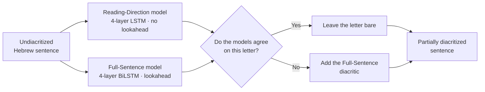
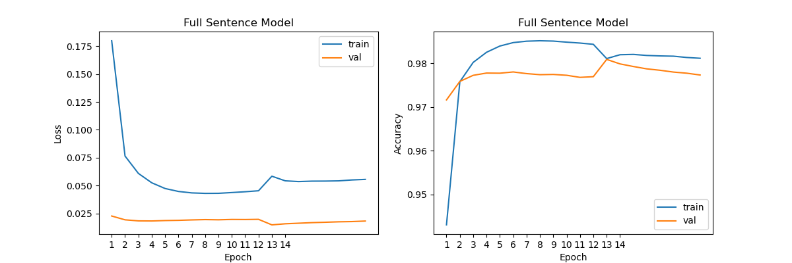
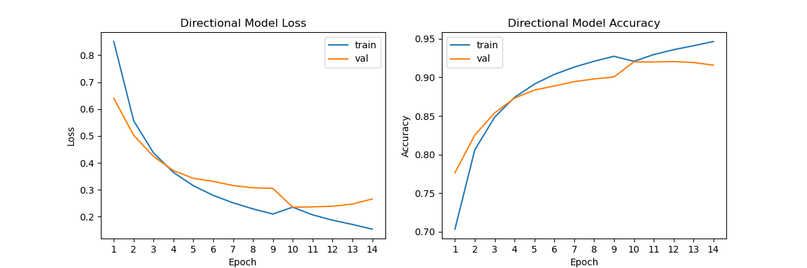
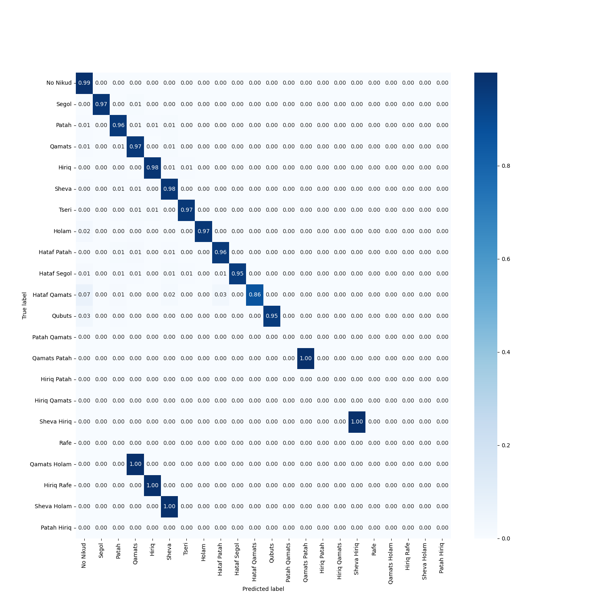
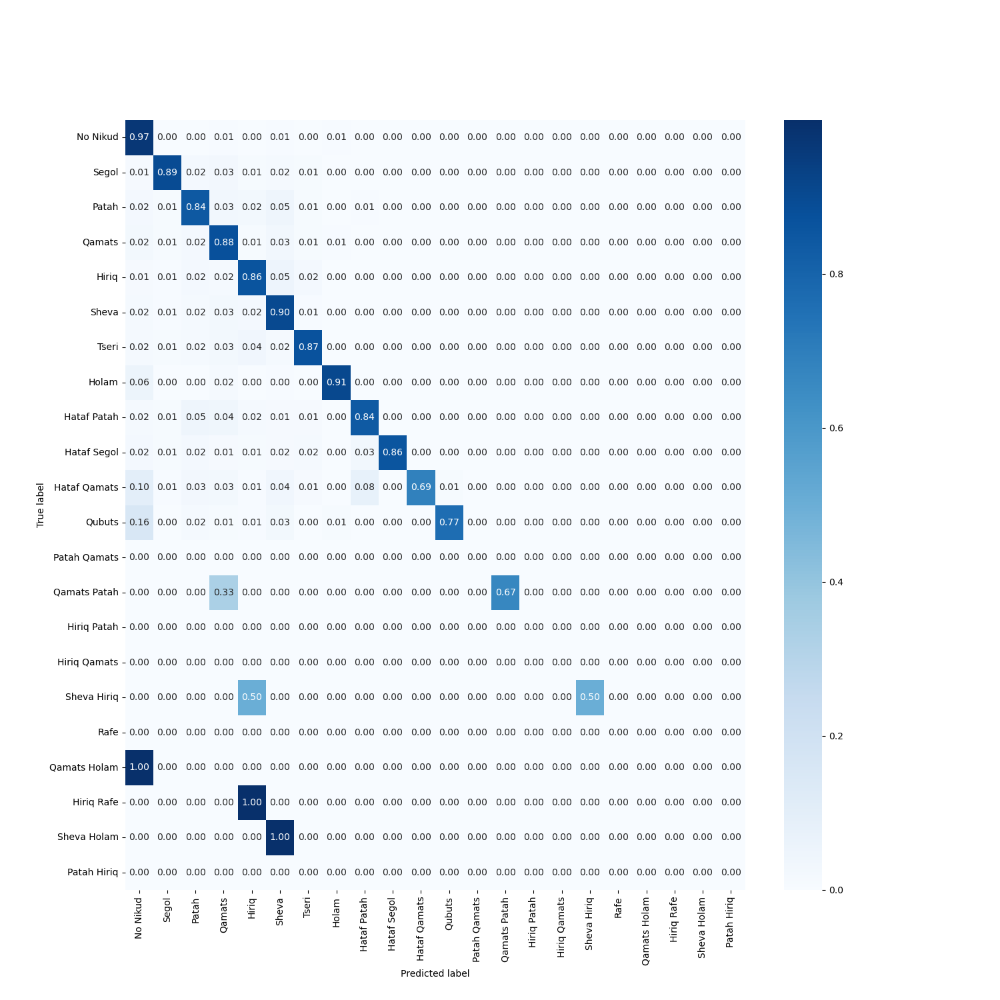
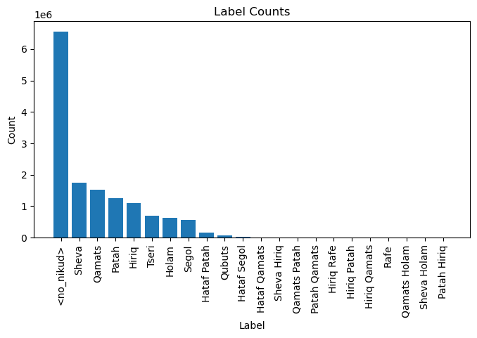

<div align="center">

# Partial Diacritization for Hebrew

**A dual-model approach that adds *just enough* nikud to make Hebrew text unambiguous**

[](From%20Arabic%20to%20Hebrew%20-%20Looking%20Ahead%20So%20We%20Dont%20Fall%20Behind%20in%20Diacritization.pdf)
[](#getting-started)
[](#how-it-works)
[](#data)

**Lior Baruch · Ben Jaim Catalan**<br>
Reichman University

[📄 Paper](From%20Arabic%20to%20Hebrew%20-%20Looking%20Ahead%20So%20We%20Dont%20Fall%20Behind%20in%20Diacritization.pdf) ·
[📓 Notebook](Partial_Dicritization_DualModel_LSTM.ipynb) ·
[📊 Results](#results) ·
[🚀 Getting started](#getting-started)

</div>

---

## Overview

Hebrew is usually written without diacritics (*nikud*). Fluent readers resolve most words from context, but some words stay ambiguous until you read further. Fully diacritized text fixes that, but it is cluttered and slower to read.

**Partial diacritization** sits in between: it marks only the letters a reader could not work out on their own.

This project adapts the method of [Esmail, Bar & Dershowitz (2022)](https://doi.org/10.1162/coli_a_00456), originally built for Arabic, to Hebrew. We train two character-level diacritizers that differ in one thing, how much of the sentence they can see:

| Model | What it sees | Role |
|---|---|---|
| **Reading-Direction** (4-layer LSTM) | The text read so far, up to the current word | Acts like a reader who hasn't looked ahead |
| **Full-Sentence** (4-layer BiLSTM) | The entire sentence | Acts like an expert with full context |

If both models agree on a letter, a reader would most likely get it right, so the letter is left bare. If they **disagree**, the letter is likely ambiguous without reading ahead, so we add the Full-Sentence model's diacritic.

### See it in action

| | Sentence |
|:--|--:|
| **Input** (no diacritics) | אבל אם מכרם לישראל אחר צריך לטובלן |
| Reading-Direction model (no lookahead) | אֲבָל אִם מִכָרָם לְיִשְרָאֵל אַחַר צָרִיךְ לְטוֹבָלֶן |
| Full-Sentence model (lookahead) | אֲבָל אִם מְכָרָם לְיִשְרָאֵל אַחֵר צָרִיךְ לְטוֹבְלָן |
| **Partial output** (4 marks) | **אבל אם מְכרם לישראל אחֵר צריך לטובְלָן** |

> *“But if he sold them to another Jew, he must immerse them.”*
>
> The word **אחר** can be read as *achar* (“after”) or *acher* (“another”). Reading in order, the Reading-Direction model guesses **אַחַר** (“after”). The Full-Sentence model sees the rest of the sentence and correctly picks **אַחֵר** (“another”). Because the models disagree, the output marks only the vowel that settles it: **אחֵר**. Letters the models agree on stay unmarked.

---

## Highlights

- 🎯 **1.93% DER / 5.24% WER** for the Full-Sentence model on 60,841 held-out sentences (98.07% of characters and 94.76% of words exactly right).
- 👀 **Lookahead matters.** Without it, errors are about 4× higher (7.98% DER / 21.84% WER). The dual model exploits exactly this gap.
- ✍️ **Light output.** Diacritics are added only where the two models disagree, so most of the text stays plain.
- 📦 **Trained checkpoints included** for every epoch of both models, along with their loss and accuracy history.

---

## How it works



### Model architecture

Both models share the same character-level design (see Figure 1 in the [paper](From%20Arabic%20to%20Hebrew%20-%20Looking%20Ahead%20So%20We%20Dont%20Fall%20Behind%20in%20Diacritization.pdf)):

1. **Character embedding.** Each letter is embedded using AlephBERT's tokenizer, with its vocabulary reduced to single characters.
2. **Word encoder.** A BiLSTM reads the characters of each word and produces a word vector $w_j$.
3. **Context encoder.** Each character embedding is concatenated with its word vector, $[c_i; w_j]$, and fed to a 4-layer **LSTM** (Reading-Direction) or **BiLSTM** (Full-Sentence).
4. **Classifier.** A linear layer predicts one diacritic label per character.

The Reading-Direction model sees the current word in full, but nothing after it. That is the "no lookahead" condition.

### Combining the models

The combination rule takes only a few lines (simplified from the `DuelModel` class in the notebook):

```python
disagreement = full_sentence_predictions != directional_predictions
combined = torch.zeros_like(directional_predictions)  # 0 = <no_nikud>
combined[disagreement] = full_sentence_predictions[disagreement]
```

---

## Results

### Diacritization accuracy

All models are evaluated on a held-out test set of **60,841 sentences** using Diacritization Error Rate (DER) and Word Error Rate (WER), following Fadel et al. (2019) and Esmail et al. (2022). **Lower is better.**

- **All characters** counts every letter, including letters that should have no diacritic.
- **Diacritized only** counts only letters that carry a diacritic in the ground truth.

| Model | DER (all) | WER (all) | DER (diacritized only) | WER (diacritized only) |
|---|:-:|:-:|:-:|:-:|
| Reading-Direction (ours, no lookahead) | 7.98 | 21.84 | 12.30 | 19.30 |
| **Full-Sentence (ours, lookahead)** | **1.93** | **5.24** | **2.97** | **4.61** |
| Dicta Nakdan<sup>*</sup> | 3.23 | 5.89 | – | – |
| Nakdimon<sup>*</sup> | 3.63 | 10.25 | – | – |

<sup>*</sup> Reported by [Gershuni & Pinter (2022)](https://doi.org/10.18653/v1/2022.findings-naacl.75) on their own test set, which includes marks this project leaves out (e.g. dagesh and shin/sin dots). These numbers give context and are not a head-to-head comparison.

### Training curves

The Full-Sentence model was trained for 20 epochs and the Reading-Direction model for 14. For each, we kept the checkpoint with the best validation accuracy.

| Full-Sentence model: best epoch **13** (98.09% val. accuracy) | Reading-Direction model: best epoch **12** (92.05% val. accuracy) |
|:-:|:-:|
|  |  |

### Confusion matrices

<details>
<summary><b>Show per-diacritic confusion matrices</b> (normalized by true label)</summary>
<br>

| Full-Sentence model | Reading-Direction model |
|:-:|:-:|
|  |  |

The Full-Sentence model gets 95–99% of each common label right. Its weakest class is the rare *Hataf Qamats* (86%), which is sometimes left without a diacritic.

</details>

### Partial diacritization examples

More test-set sentences from the notebook. When the models fully agree, as in the last row, nothing is added.

| Partial output | Marks added |
|--:|:-:|
| ויל דהא התוס כתבו שם לְחד תי דהי ברירא לי דהלכה כר יוסִי דְמכשיר רק בפני עַם הארץ הי מחְמיר | 5 |
| ומשמע דדווקא לענין לִיפסול מן התרומה פליגי | 1 |
| לא יקח ממנה הפרוטה | 0 |

<details>
<summary><b>Show both model predictions for each example</b></summary>
<br>

**Example 1**

| | Sentence |
|:--|--:|
| Ground truth | ויל דְהָא הַתוֹסָ כָתְבו שָם לְחַד תי דהי בְרִירָא לי דַהֲלָכָה כר יוֹסִי דְמַכְשִיר רַק בִפְנֵי עַם הָאָרֶץ הי מַחְמִיר |
| Reading-Direction model | ויל דְהָא הַתוֹסָ כָתְבו שָם לָחַד תי דהי בְרִירָא לי דַהֲלָכָה כר יוֹסֵי דִמַכְשִיר רַק בִפְנֵי עֵם הָאָרֶץ הי מַחֲמִיר |
| Full-Sentence model | ויל דְהָא הַתוֹסָ כָתְבו שָם לְחַד תי דהי בְרִירָא לי דַהֲלָכָה כר יוֹסִי דְמַכְשִיר רַק בִפְנֵי עַם הָאָרֶץ הי מַחְמִיר |
| **Partial output** | **ויל דהא התוס כתבו שם לְחד תי דהי ברירא לי דהלכה כר יוסִי דְמכשיר רק בפני עַם הארץ הי מחְמיר** |

**Example 2**

| | Sentence |
|:--|--:|
| Ground truth | ומַשְמַע דְדַוְוקָא לְעִנְיַן לִיפְסֹול מִן הַתְרומָה פְלִיגִי |
| Reading-Direction model | ומַשְמַע דְדַוְוקָא לְעִנְיַן לְיפְסֹול מִן הַתְרומָה פְלִיגִי |
| Full-Sentence model | ומַשְמַע דְדַוְוקָא לְעִנְיַן לִיפְסֹול מִן הַתְרומָה פְלִיגִי |
| **Partial output** | **ומשמע דדווקא לענין לִיפסול מן התרומה פליגי** |

**Example 3**

| | Sentence |
|:--|--:|
| Ground truth | לֹא יִקַח מִמֶנָה הַפְרוטָה |
| Reading-Direction model | לֹא יִקַח מִמֶנָה הַפְרוטָה |
| Full-Sentence model | לֹא יִקַח מִמֶנָה הַפְרוטָה |
| **Partial output** | **לא יקח ממנה הפרוטה** |

</details>

> **Note:** there is no human-annotated benchmark for Hebrew partial diacritization yet, so the partial output is evaluated qualitatively, as in the paper.

---

## Data

We use the **[Dicta Library](https://github.com/Dicta-Israel-Center-for-Text-Analysis/Dicta-Library-Download)**, a large collection of diacritized books, mostly rabbinic literature printed in the 19th and early 20th centuries. [`data/books.json`](data/books.json) lists the books and their download links.

**Preprocessing**

1. Split each text into sentences on `.` and line breaks.
2. Remove quotes, parentheses and marks outside the target set (dagesh, shin/sin dots, meteg, siluk).
3. Because of compute limits, take the first 500,000 sentences and keep those of up to 100 letters (not counting spaces). This gives **304,205 sentences**.
4. Split randomly (seed 42) into **194,691 train / 48,673 validation / 60,841 test** sentences.

**Labels.** Each letter gets one of the 11 vowel signs below, `<no_nikud>`, or one of a few rare combinations found in the data (22 classes in total).

| Sheva | Hataf Segol | Hataf Patah | Hataf Qamats | Hiriq | Tseri | Segol | Patah | Qamats | Holam | Qubuts |
|:-:|:-:|:-:|:-:|:-:|:-:|:-:|:-:|:-:|:-:|:-:|
| בְ | בֱ | בֲ | בֳ | בִ | בֵ | בֶ | בַ | בָ | בֹ | בֻ |

<details>
<summary><b>Show label distribution</b></summary>
<br>



</details>

---

## Training details

**Hyperparameter search.** We ran a grid search on a random subset of 5,000 sentences, taking about 24 hours per architecture:

| Hyperparameter | Values searched |
|---|---|
| (Word, character) embedding size | (16, 32), (32, 64), (64, 128) |
| Hidden size | 512, 1024 |
| Learning rate | 1e-3, 1e-4 |
| `<no_nikud>` loss weight | 1, 0.5 |
| Epochs | 1–20 (best by validation accuracy) |

**Final configuration.** Both models were trained on the full training split with Adam, batch size 32 and dropout 0.2. Each epoch took about 1h20m on an NVIDIA RTX 3080.

| | Reading-Direction | Full-Sentence |
|---|:-:|:-:|
| Sequence encoder | 4-layer LSTM | 4-layer BiLSTM |
| Word / character embedding | 32 / 64 | 16 / 32 |
| Hidden size | 512 | 512 |
| Learning rate | 1e-3 | 1e-3 |
| `<no_nikud>` loss weight | 1 (unweighted) | 1 (unweighted) |
| Best epoch | 12 | 13 |

We first tried a Transformer-based full-sentence model, as in Esmail et al., but it did not reach good enough results. That attempt is kept in [`transformer_attempt.ipynb`](transformer_attempt.ipynb).

---

## Repository structure

```text
.
├── Partial_Dicritization_DualModel_LSTM.ipynb  # Main pipeline: data prep, models, grid search,
│                                               # training, evaluation and the dual model
├── transformer_attempt.ipynb                   # Earlier Transformer-based experiment
├── From Arabic to Hebrew - ... .pdf            # Project paper
├── full-sentence-final-models/                 # Full-Sentence checkpoints per epoch + loss/accuracy history
├── reading-direction-final-models/             # Reading-Direction checkpoints per epoch + loss/accuracy history
├── plots/                                      # Training curves, confusion matrices, label distribution
├── data/
│   ├── books.json                              # Dicta Library index used to download the corpus
│   └── morphologicaltagging_v_2_1.csv          # Hebrew morphological-tagging data (not used by the main notebook)
└── AlephBERT-main/AlephBERT-main/              # AlephBERT code; its tokenizer is adapted to single characters
```

---

## Getting started

### 1. Clone and install

```bash
git clone https://github.com/Lior-Baruch/Partial_Diacritization.git
cd Partial_Diacritization
pip install numpy pandas matplotlib seaborn scikit-learn torch tokenizers transformers tqdm requests
```

> The repository includes a checkpoint for every epoch (about 2 GB in total), so the clone can take a while. A CUDA GPU is strongly recommended for training.

### 2. Add the character-level tokenizer

The notebook loads a tokenizer from `AlephBERT-main/AlephBERT-main/models/alephbert-base/`. This folder is git-ignored, so you need to create it:

1. Download [`onlplab/alephbert-base`](https://huggingface.co/onlplab/alephbert-base) into that folder.
2. Edit its `vocab.txt` so it keeps only the special tokens and single-character tokens.

> The released checkpoints expect the same 1,802-token vocabulary used in training. If your edited vocabulary differs, retrain the models instead of loading the checkpoints.

### 3. Download and prepare the data

In the notebook, uncomment the download cell. It fetches every book listed in `data/books.json` into `data/texts/`. The cells after it build the cleaned dataset (`data/full_data_without_puncts.csv` / `.json`).

### 4. Run the notebook

Open [`Partial_Dicritization_DualModel_LSTM.ipynb`](Partial_Dicritization_DualModel_LSTM.ipynb) and run it top to bottom:

- The **grid search** is off by default (`RUN_GRID_SEARCH = False`).
- The **training loops** skip any epoch whose checkpoint already exists, so with the provided checkpoints the notebook loads the trained models instead of retraining them.
- The final cells run the **dual model** on test batches and print each model's prediction next to the partial output.

> The checkpoints were saved on GPU. To load them on a CPU-only machine, pass `map_location="cpu"` to `torch.load`.

---

## Limitations and future work

- **Domain.** The Dicta corpus is mostly rabbinic text from the 19th and early 20th centuries. Performance on modern Hebrew (news, fiction, everyday text) has not been measured yet.
- **Diacritic coverage.** Dagesh, shin/sin dots and vowel-length distinctions are left for future work.
- **Evaluating partial output.** A human-annotated benchmark would allow a quantitative evaluation of the partial diacritization itself.
- **Applications.** A natural use case is helping children and new Hebrew learners move from fully diacritized text to plain text.

---

## Citation

If you use this work, please cite:

```bibtex
@misc{baruch2023partialdiacritization,
  title        = {From Arabic to Hebrew: Looking Ahead So We Don't Fall Behind in Diacritization},
  author       = {Baruch, Lior and Catalan, Ben Jaim},
  year         = {2023},
  howpublished = {\url{https://github.com/Lior-Baruch/Partial_Diacritization}}
}
```

## References

1. S. Esmail, K. Bar, N. Dershowitz. *How Much Does Lookahead Matter for Disambiguation? Partial Arabic Diacritization Case Study.* Computational Linguistics, 2022. [doi:10.1162/coli_a_00456](https://doi.org/10.1162/coli_a_00456)
2. A. Shmidman et al. *Nakdan: Professional Hebrew Diacritizer.* 2020. [arXiv:2005.03312](https://doi.org/10.48550/arXiv.2005.03312)
3. E. Gershuni, Y. Pinter. *Restoring Hebrew Diacritics Without a Dictionary.* Findings of NAACL, 2022. [doi:10.18653/v1/2022.findings-naacl.75](https://doi.org/10.18653/v1/2022.findings-naacl.75)
4. A. Seker et al. *AlephBERT: A Pre-trained Language Model to Start Off Your Hebrew NLP Application.* 2021. [GitHub](https://github.com/OnlpLab/AlephBERT)
5. Dicta. *Dicta Library Download.* [GitHub](https://github.com/Dicta-Israel-Center-for-Text-Analysis/Dicta-Library-Download)
6. *Usage and examples of partial diacritics in Hebrew* (in Hebrew). [Leshoniada](https://leshoniada.co.il/2019/09/01/%D7%A0%D7%99%D7%A7%D7%95%D7%93-%D7%9E%D7%A1%D7%99%D7%99%D7%A2-%D7%A9%D7%91%D7%A4%D7%95%D7%A2%D7%9C-%D7%90%D7%99%D7%A0%D7%95-%D7%9E%D7%A1%D7%99%D7%99%D7%A2-%D7%9B%D7%9C%D7%9C/)

## Acknowledgments

This project was carried out as part of the NLP course at Reichman University, under the supervision of **Kfir Bar**. The included AlephBERT code belongs to the [ONLP Lab at Bar-Ilan University](https://github.com/OnlpLab/AlephBERT).

For questions or collaboration, please [open an issue](https://github.com/Lior-Baruch/Partial_Diacritization/issues) or contact the authors.
